# Infrastructure du POS Aigle d'Or

Ce document est le point d'entrée technique pour toute personne ou tout nouvel agent qui doit comprendre, corriger ou faire évoluer la vente directe du projet **Aigle d'Or**. Il décrit l'état actuel de l'application, ses dépendances avec le framework APJ, ses contrats DOM et HTTP, sa navigation clavier, ses tests et son déploiement local.

> **Périmètre des chemins**
>
> Sauf indication contraire, tous les chemins `socobis-*` cités ci-dessous sont relatifs à `/Users/apple/Documents/GitHub/aigledor`.

## 1. Ce qu'il faut savoir avant toute modification

Le POS est une page JSP rendue par le framework APJ. Il ne s'agit pas d'une application front-end autonome : une partie importante du formulaire, notamment les lignes du panier, est générée en Java par `PageInsertMultiple`.

Les règles essentielles sont les suivantes :

- préserver les `id`, `name`, classes et suffixes `_N` utilisés par APJ et les modules JavaScript ;
- conserver l'ordre de chargement des modules `pos-*.js` ;
- ne pas remplacer la soumission contrôlée par un appel direct à `form.submit()`, car celui-ci contourne les listeners et les validations ;
- traiter le fichier backup comme une référence fonctionnelle, jamais comme la version à déployer ;
- ne pas modifier le cœur du framework APJ pour résoudre un problème local au POS sans analyser l'impact sur les autres projets clients ;
- préserver les modifications sans rapport déjà présentes dans les dépôts ;
- tester la navigation avec `event.key` et `event.code`, en particulier sur un clavier QWERTY japonais et pendant une composition IME.

La page actuellement déployée active explicitement le mode clavier :

```javascript
window.isKeyboardMode = true;
document.body.classList.add('pos-kb-mode');
```

Le clavier virtuel reste dans le code pour les autres modes, mais il ne s'ouvre pas lorsque `window.isKeyboardMode === true`.

## 2. Carte des fichiers

### Page et traitement serveur

| Rôle | Fichier |
|---|---|
| Page POS active | `socobis-war/web/pages/vente/vente-saisie-directe-apj.jsp` |
| Référence fonctionnelle historique | `socobis-war/web/pages/vente/vente-saisie-directe-apj-backup.jsp` |
| Traitement de la vente après POST | `socobis-war/web/pages/vente/apresVenteDirecteOptim.jsp` |
| Génération/affichage du ticket PDF | `socobis-war/web/pages/vente/flux_pdf.jsp` |
| Recherche de remise produit/client/point | `socobis-war/src/java/servlet/IngredientsRemiseServlet.java` |
| Recherche d'un produit par code-barres balance | `socobis-war/src/java/servlet/ApresTarif.java` |

### Front-end

| Rôle | Fichier |
|---|---|
| Style propre au POS | `socobis-war/web/assets/css/vente-directe.css` |
| Variables, typographies et composants APJ | `socobis-war/web/assets/css/apj-global-style.css` |
| Utilitaires de base | `socobis-war/web/assets/js/pos/pos-core.js` |
| Panier et produits | `socobis-war/web/assets/js/pos/pos-basket-handlers.js` |
| Paiement | `socobis-war/web/assets/js/pos/pos-payment.js` |
| Clavier visuel et interactions UI | `socobis-war/web/assets/js/pos/pos-ui-handlers.js` |
| LCD et synchronisation locale/socket | `socobis-war/web/assets/js/pos/pos-hardware-handlers.js` |
| Navigation clavier physique | `socobis-war/web/assets/js/pos/pos-keyboard.js` |
| Sélection clavier globale des listes | `socobis-war/web/assets/js/pos/pos-select-keyboard.js` |
| Navigation clavier des opérations de caisse | `socobis-war/web/assets/js/pos/pos-cash-keyboard.js` |
| Navigation clavier de connexion et fermeture de session | `socobis-war/web/assets/js/pos/pos-page-keyboard.js` |
| Initialisation et branchement des événements | `socobis-war/web/assets/js/pos/pos-events.js` |
| Runner de tests navigateur | `socobis-war/web/assets/js/tests/test-runner.html` |
| Mini-framework de test | `socobis-war/web/assets/js/tests/pos-test-runner.js` |
| Suites de tests | `socobis-war/web/assets/js/tests/suites/` |

Le backup est un ancien fichier monolithique d'environ 4 000 lignes avec du JavaScript inline. La page active est volontairement plus courte et délègue son comportement aux modules `pos-*.js`.

## 3. Relation entre Aigle d'Or et le framework APJ

Le dépôt `moteur-apj` est une bibliothèque J2EE partagée par plusieurs applications clientes. Aigle d'Or en consomme les JAR dans son répertoire `build-file/lib`.

APJ suit une architecture Model 1 maison :

1. une URL ouvre directement une JSP, souvent par le paramètre `but` de `module.jsp` ;
2. la JSP instancie une classe `affichage.Page`, ici `PageInsertMultiple` ;
3. APJ génère le HTML du formulaire par concaténation de chaînes Java ;
4. les paramètres POST sont reliés aux objets métier par réflexion ;
5. les objets héritant de `ClassMAPTable` sont persistés par l'ORM maison avec `CGenUtil` et les services APJ ;
6. le contexte utilisateur, le point de vente, le magasin et la caisse proviennent principalement de la session et de `UserEJB`.

Le routage habituel du POS est :

```text
/aigledor/pages/module.jsp
    ?but=vente/vente-saisie-directe-apj.jsp
    &id=<identifiant éventuel>
```

Le cœur d'APJ est partagé entre Aigle d'Or, Axelle, async-hotel, socobis et d'autres applications. Les classes comme `Page`, `PageInsertMultiple`, `Formulaire`, `Champ`, `ClassMAPTable`, `ClassMere` et `CGenUtil` ont donc une portée globale.

Pour comprendre le framework en profondeur, lire également dans le dépôt `moteur-apj` :

- `AGENTS.md` pour les règles de travail et de compilation ;
- `FRAMEWORK_CONTEXT.md` pour le cycle des requêtes, le rendu et la persistance.

## 4. Construction de la page POS

La JSP active prépare une vente mère et une ligne fille APJ :

```java
String classeMere = "vente.VentePaiement";
String classeFille = "vente.VenteDetails";
String colonneMere = "idVente";

Vente mere = new InsertionVente();
mere.setNomTable("INSERTION_VENTE_PERSONNEL_VIDE");

VenteDetailsLib fille = new VenteDetailsLib();
fille.setNomTable("VENTE_DETAILS_SAISIE_DIRECTE");

PageInsertMultiple pi = new PageInsertMultiple(mere, fille, request, 1, u);
```

Le client par défaut est `Client Divers` avec l'identifiant `CLI000576`. Il est remplacé par le client associé au point de vente lorsqu'il existe.

La recherche produit s'appuie sur deux mécanismes APJ :

- l'input principal `#idProduit_libelle` déclenche `autoCompleteVenteDirect(...)` sur la vue `ST_INGREDIENTSVENTEPOS` ;
- le champ fille APJ reçoit un `setPageAppelComplete(...)` fondé sur `ST_INGREDIENTSAUTOVENTE_MGA2`.

Le formulaire mère et le tableau fille sont générés avec :

```java
pi.getFormu().makeHtmlInsertTabIndex();
pi.getFormufle().makeHtmlInsertTableauIndex();
```

La ligne fille d'indice `0` sert à la fois de première ligne et de structure de référence pour les lignes ajoutées. Le bouton APJ `#addLines` crée les indices suivants.

## 5. Cycle complet d'une vente

```mermaid
flowchart LR
    A[Recherche ou scan produit] --> B[Autocomplete APJ ou code-barres balance]
    B --> C[Création ou réutilisation d'une ligne APJ]
    C --> D[Remise selon produit, client et point]
    D --> E[Calcul du panier et synchronisation]
    E --> F[Choix du ou des paiements]
    F --> G[Validation front-end]
    G --> H[POST vers apresVenteDirecteOptim.jsp]
    H --> I[Création VentePaiement et VenteDetails]
    I --> J[Ticket flux_pdf.jsp]
    J --> K[Redirection vers la page POS]
```



Le front-end ne doit jamais inventer un second format métier. Il prépare les champs attendus par le traitement JSP et laisse APJ créer les objets serveur.

## 6. Ordre de chargement des modules JavaScript

La page définit d'abord les variables globales :

```javascript
window.contextPath;
window.lienAccueil;
window.idPoint;
window.isKeyboardMode;
```

Elle charge ensuite `socket.io.min.js`, puis les modules dans cet ordre strict :

1. `pos-core.js`
2. `pos-basket-handlers.js`
3. `pos-payment.js`
4. `pos-ui-handlers.js`
5. `pos-hardware-handlers.js`
6. `pos-keyboard.js`
7. `pos-events.js`

Les pages d'ouverture, clôture, entrée, sortie et virement chargent uniquement `pos-cash-keyboard.js` pour leur navigation physique. Elles conservent leur clavier visuel et leur JavaScript métier inline.

`index.jsp` et `pages/caisse/mvt/fermeture-session.jsp` chargent `pos-page-keyboard.js`. La page de connexion utilise le mode `form`; la fermeture de session utilise le mode `actions` pour parcourir ses trois boutons avec les flèches et les activer avec Entrée.

Chaque module utilise une IIFE et expose les fonctions utiles sur `window`. Il n'y a ni bundler, ni import ES module, ni framework JavaScript moderne.

### `pos-core.js`

Responsabilités :

- convertir et afficher les montants (`parseAmount`, `formatAmount`) ;
- arrondir le total au multiple de 100 le plus proche ;
- interpréter les codes-barres de balance de 13 chiffres commençant par `20`, `21` ou `22` ;
- interroger `/ApresTarif?acte=pos&reference=...` ;
- résoudre l'image produit et manipuler l'affichage des cellules.

### `pos-basket-handlers.js`

Responsabilités :

- ajouter un produit et incrémenter une ligne existante en cas de doublon ;
- gérer les lignes APJ, les quantités, le prix, les remises et les produits au poids ;
- appeler `/IngredientsRemiseServlet` en POST avec `idProduit`, `idClient` et `idPoint` ;
- recalculer le sous-total, les remises et le total ;
- supprimer une ligne puis resynchroniser le panier ;
- demander une confirmation visuelle lorsque `-` ou le bouton moins ferait passer une quantité de 1 à 0 ;
- enregistrer et restaurer temporairement le panier avec `sessionStorage` ;
- rafraîchir les boutons, l'image et l'aperçu produit.

### `pos-payment.js`

Responsabilités :

- faire la correspondance entre les huit modes de paiement et leurs champs ;
- afficher les sections utiles au mode sélectionné ;
- calculer le montant payé et la monnaie à rendre ;
- plafonner les montants lorsque le paiement multiple l'exige ;
- afficher et masquer les erreurs ;
- désactiver le bouton `Payer` tant que la vente n'est pas valide ;
- protéger la soumission avec le listener `submit`.

### `pos-ui-handlers.js`

Responsabilités :

- ouvrir et fermer le clavier visuel hors mode clavier physique ;
- suivre l'input actif et appliquer les touches du clavier visuel ;
- gérer l'appui prolongé sur certaines commandes ;
- rattacher le logo au lien d'accueil.

### `pos-hardware-handlers.js`

Responsabilités :

- envoyer un texte à l'afficheur LCD par POST JSON vers `http://192.168.88.90:3100/lcd` ;
- sérialiser le panier dans `localStorage` sous la clé `products` ;
- émettre `send_products` uniquement si `window.socket` existe et est connecté ;
- rattacher les listeners de synchronisation aux lignes générées par APJ.

Le socket n'est pas utilisé dans le fonctionnement actuel. La bibliothèque reste chargée et `sendProducts()` est appelé toutes les 30 secondes, mais la fonction ne fait rien si aucun objet `window.socket` valide n'existe. Une panne du LCD ou du socket ne doit pas bloquer une vente.

### `pos-keyboard.js`

Responsabilités :

- maintenir les états `SEARCH`, `BASKET` et `PAYMENT` ;
- déplacer le focus dans le header, le menu déroulant, le panier et le paiement ;
- gérer les raccourcis globaux et l'aide ;
- appliquer `+`, `-`, `Suppr` et `Backspace` uniquement à la ligne panier réellement active ;
- laisser l'autocomplete traiter ses propres touches quand il est ouvert ;
- ignorer les raccourcis de saisie directe pendant une composition IME ou avec un modificateur non prévu.

### `pos-cash-keyboard.js`

Responsabilités :

- mutualiser les raccourcis des cinq opérations de caisse ;
- parcourir les champs APJ visibles et modifiables avec Haut/Bas, sans intercepter Tab ;
- naviguer dans le header et son dropdown ;
- ouvrir l'aide avec F1 ou Ctrl + H et valider avec Ctrl/Shift + Entrée ;
- piloter au clavier le modal de billetage de l'ouverture et de la clôture ;
- rediriger `Ctrl + F` vers la vente directe et y focaliser la recherche via `sessionStorage.posPendingProductSearch` ; `Shift + F` reste libre hors du POS ; les pages de caisse ne contiennent pas de champ de recherche, mais conservent le conteneur `.form-input.w-100` pour la mise en page du header.

### `pos-select-keyboard.js`

Responsabilités :

- détecter automatiquement les `select` simples, y compris ceux ajoutés dynamiquement ;
- ouvrir la liste avec Entrée, parcourir ses options avec Haut/Bas et confirmer avec Entrée ;
- fermer sans modifier avec Échap, laisser Tab natif et restaurer les flèches de navigation après fermeture ;
- déclencher `input` et `change` uniquement lorsque la valeur confirmée diffère de la valeur initiale ;
- prendre en charge Select2 et rester inactif hors des modes clavier APJ.

### `pos-page-keyboard.js`

Responsabilités :

- focaliser le premier champ de connexion au chargement ;
- faire avancer Entrée entre les champs et laisser les `select` au module global ;
- déclencher le bouton de connexion avec Ctrl/Shift + Entrée via son clic natif ;
- parcourir en boucle les actions de fermeture de session selon leur ordre visuel avec les quatre flèches et les activer avec Entrée ;
- fournir un focus visible de 3 px sur ces deux pages.

### `pos-events.js`

Responsabilités :

- initialiser la page au `DOMContentLoaded` ;
- brancher les modes et champs de paiement ;
- normaliser les valeurs numériques ;
- enregistrer le panier juste avant une soumission valide ;
- observer les lignes ajoutées dynamiquement ;
- initialiser le montant espèces et les remises client ;
- centraliser le loader et les erreurs globales.

Plusieurs initialisations sont également appelées dans le bloc final du JSP. Les fonctions utilisent des marqueurs `dataset` lorsqu'un listener ne doit être ajouté qu'une fois. Avant de déplacer une initialisation, vérifier qu'elle ne dépend pas du HTML généré après coup.

## 7. Contrat DOM à préserver

Ces sélecteurs constituent une API interne entre le JSP, APJ, le CSS et le JavaScript.

### Structure principale

| Sélecteur | Usage |
|---|---|
| `#venteForm` | Formulaire envoyé au serveur |
| `.vd-header` | Header et navigation clavier |
| `#idProduit_libelle` | Recherche, scan et autocomplete produit |
| `#idProduit` | Identifiant caché du produit sélectionné |
| `#dropdownMenu1` | Bouton du menu Mouvement |
| `#formTableContainer` | Formulaire client et panier générés par APJ |
| `#butfillejsp` | Conteneur des lignes de détails |
| `#ajout_multiple_ligne` | Tableau APJ des lignes multiples |
| `#ligne-multiple-N` | Ligne panier d'indice `N` |
| `#addLines` | Ajout d'une ligne APJ |
| `.vente-directe-right-container` | Résumé et paiement |
| `#globalLoader` | Blocage visuel pendant le traitement |
| `#pos-help-modal` | Aide clavier |

### Champs générés pour chaque ligne `N`

Les champs suivants sont lus ou alimentés par le front-end et le serveur :

```text
idProduit_N
idProduit_Nlibelle
designation_N
qte_N
pu_N
pvTva_N
montantTTC_N
remise_N
remiseMontant_N
unite_N
compte_N
reference_N
photo_N
basePriceKg_N
idDevise_N
tauxDeChange_N
estEnGros_N
```

Certains champs peuvent être invisibles mais restent nécessaires au binding APJ. Ne pas les supprimer parce qu'ils ne sont pas affichés.

### Récapitulatif et paiement

| Sélecteur | Usage |
|---|---|
| `#recapSousTotal` | Sous-total affiché |
| `#recapRemises` | Total des remises affiché |
| `#totalGeneral` | Total final affiché |
| `#totalGeneralInput` | Total final envoyé au serveur |
| `#montantFacture` | Montant de la facture affiché |
| `#montantPayerTexte` | Montant payé affiché |
| `#montantRetourner` | Monnaie à rendre affichée |
| `#aretourner` | Monnaie à rendre envoyée au serveur |
| `#multiple-payment` | Choix visible du paiement multiple |
| `#multiplePaymentInput` | Valeur `true`/`false` envoyée au serveur |
| `input[name="payment-method"]` | Mode de paiement simple sélectionné |
| `.toggle-container .toggle-button` | Choix navigables au clavier |
| `.paiement-section[data-mode]` | Champs affichés selon le mode |

## 8. Panier, prix et remises

Lorsqu'un produit est choisi :

1. le code cherche d'abord une ligne portant déjà le même produit ;
2. s'il la trouve, il augmente sa quantité ;
3. sinon, il réutilise la ligne `0` vide ou déclenche `#addLines` ;
4. il renseigne les champs visibles et cachés de la nouvelle ligne ;
5. il demande la remise applicable ;
6. il recalcule les totaux, synchronise l'afficheur et sauvegarde l'état utile ;
7. en mode clavier, il place le focus logique sur le panier.

Pour un article normal, le montant brut est fondé sur `quantité × prix unitaire`. Pour une unité au poids, actuellement reconnue par `UNT00004`, le prix peut déjà représenter le montant calculé depuis le code-barres de balance. Toute modification du calcul doit donc tester séparément article unitaire et article pesé.

Le total final est arrondi au multiple de 100 le plus proche. Les valeurs affichées contiennent des espaces et `Ar`, alors que les valeurs utilisées pour le calcul et le POST sont normalisées par `parseAmount`.

L'indice clavier actif correspond à la liste retournée par `getBasketElements()`. Il ne faut pas supposer qu'il correspond directement à un `nth-child` ni à une liste filtrée différente. Pour `+`, `-` et la suppression, résoudre d'abord la ligne avec `getActiveBasketRow()`.

## 9. Modes de paiement et contrat POST

Les huit modes disponibles sont :

| Mode UI | Montant | Référence |
|---|---|---|
| `especes` | `valeurEspece` | aucune |
| `mvola` | `montantMvola` | `refMvola` |
| `orange` | `montantOrange` | `refOrange` |
| `airtel` | `montantAirtel` | `refAirtel` |
| `cheque` | `montantCheque` | `refCheque` |
| `visa` | `montantVisa` | `refVisa` |
| `bonAchat` | `montantBOA` | `refBOA` |
| `cadeaux` | `montantCarte` | `refCarte` |

Le formulaire envoie aussi le contrat APJ suivant :

```text
acte=insert
action=insert
bute=vente/vente-saisie-directe-apj.jsp
classe=vente.VentePaiement
classefille=vente.VenteDetails
nombreLigne=<nombre de lignes APJ>
colonneMere=idVente
nomtable=Vente_Details
idPoint=<point de vente courant>
multiplePayment=true|false
```

`apresVenteDirecteOptim.jsp` :

1. relit les paramètres APJ et reconstruit les objets par réflexion ;
2. construit un tableau de `PaiementInfo` ;
3. en mode multiple, ajoute chaque montant non nul avec sa catégorie et sa référence ;
4. en mode simple, déduit la caisse depuis `payment-method` ;
5. complète la vente avec le point, le magasin, la caisse et l'utilisateur courants ;
6. appelle `u.createObjectMultipleBatch(v, colonneMere, cfille)` ;
7. retire `cartStateBeforeSubmit` du `sessionStorage` dans le navigateur ;
8. charge le ticket par `flux_pdf.jsp?idVente=...`, puis retourne vers le POS.

Le bouton `Payer` est le point d'entrée de la validation. S'il est désactivé, aucun raccourci ne doit soumettre le formulaire. Un `form.submit()` direct est interdit ici, car il contourne le listener `submit`, `attachSubmitGuard`, la normalisation et `saveCartState()`.

## 10. Navigation clavier

La navigation repose sur trois zones logiques :

- `SEARCH` : recherche produit, autocomplete et header ;
- `BASKET` : lignes du panier ;
- `PAYMENT` : paiement multiple, modes, références et montants.

### Raccourcis actifs

| Touche | Effet |
|---|---|
| `F1` ou `Ctrl + H` | Afficher ou masquer l'aide |
| `Ctrl + Entrée` ou `Shift + Entrée` | Déclencher `Payer` s'il est actif |
| `Shift + F` ou `Ctrl + F` | Revenir à la recherche produit |
| `Shift + M` | Aller à la zone de paiement |
| `Shift + Tab` | Basculer entre panier et paiement |
| `Tab` | Comportement natif/autocomplete, sans changement de zone POS |
| Flèches | Naviguer dans le header, le dropdown, le panier ou les paiements |
| `Entrée` | Activer le lien, le bouton, le mode ou le champ ciblé |
| `+` | Augmenter la quantité de la ligne panier active |
| `-` | Diminuer la quantité de la ligne panier active, sans passer sous zéro |
| `Suppr` ou `Backspace` | Supprimer uniquement la ligne panier active |

Depuis la recherche, `Entrée` laisse la priorité à l'autocomplete lorsqu'il est ouvert. Sinon, elle place le focus sur le premier bouton visible du header. Les flèches permettent ensuite de parcourir ses boutons et le menu Mouvement ; `Entrée` active les liens.

Sur un clavier QWERTY japonais, `-` peut être remonté sous plusieurs formes. Le handler couvre actuellement `event.key` égal à `-`, `Subtract` ou `−`, et `event.code` égal à `Minus` ou `NumpadSubtract`. La saisie directe vers la barre de recherche doit ignorer `Shift`, `Ctrl`, `Alt`, `Meta` et `event.isComposing`, sinon des raccourcis comme `Cmd + +` ou une composition japonaise peuvent injecter un caractère dans la recherche.

Les anciens badges visuels `Shift + Tab` et `Shift + F` ont été retirés. Le modal d'aide reste disponible avec `F1` et `Ctrl + H`.

## 11. État local, restauration et périphériques

### Panier temporaire

`saveCartState()` stocke une copie dans :

```text
sessionStorage.cartStateBeforeSubmit
```

La restauration accepte cet état pendant cinq minutes (`300000 ms`). L'entrée est supprimée après restauration, expiration, erreur de lecture ou vente réussie. Ce mécanisme protège contre une navigation ou une soumission interrompue ; il ne remplace pas la persistance serveur.

### Synchronisation locale

`sync()` collecte les articles, écrit `localStorage.products`, puis tente l'émission socket. Les listeners sont posés sur les champs des lignes et sur les liens des cellules. Les attributs `data-listener-added` évitent les doublons.

### Afficheur LCD

`sendMessage()` effectue un POST JSON de la forme :

```json
{ "message": "BIENVENUE !!!" }
```

L'adresse est actuellement codée en dur. Une erreur réseau est journalisée dans la console, sans interrompre la caisse.

## 12. CSS et règles de mise en page

Le POS charge `vente-directe.css`. Les tokens globaux et les classes typographiques viennent d'`apj-global-style.css`, normalement chargé par le shell de l'application.

Pour toute nouvelle règle :

- réutiliser les variables `--Bases-4-space-*`, les couleurs APJ et les classes de titre existantes ;
- préférer une classe métier stable à `:nth-child(...)` ;
- éviter les sélecteurs dépendant du nombre de blocs générés par APJ ;
- conserver un focus très visible en mode clavier, actuellement renforcé autour des contrôles actifs ;
- vérifier le rendu à la résolution réelle de la caisse et avec un panier long ;
- ne pas déplacer un champ caché hors du formulaire.

Les classes comme `.toggle-button`, `.link`, `.paiement-section`, `.active`, `.d-none` et `.pos-kb-*` sont aussi lues par le JavaScript. Un changement purement visuel peut donc avoir un effet fonctionnel s'il modifie leur présence ou leur visibilité.

## 13. Tests automatisés

Le runner POS est autonome et s'exécute dans un navigateur. Il contient actuellement **80 tests** :

- 7 tests core ;
- 4 tests panier ;
- 11 tests paiement ;
- 1 test UI ;
- 5 tests hardware ;
- 20 tests clavier POS ;
- 15 tests clavier pour les opérations de caisse ;
- 5 tests clavier pour la connexion et la fermeture de session.
- 12 tests du sélecteur clavier global.

Les régressions clavier couvertes incluent :

- `+` et `-` ne modifient que l'article focalisé, même lorsque des champs client précèdent le panier ;
- `Suppr` depuis le paiement ne retire aucun article ;
- un raccourci de validation ne contourne pas un bouton `Payer` désactivé ;
- `Entrée` depuis la recherche cible le premier bouton visible du header.

### Vérification syntaxique

Depuis `/Users/apple/Documents/GitHub/aigledor` :

```bash
for f in socobis-war/web/assets/js/pos/*.js \
         socobis-war/web/assets/js/tests/suites/*.js; do
  node --check "$f" || exit 1
done
```

### Exécution du runner

```bash
cd /Users/apple/Documents/GitHub/aigledor/socobis-war/web/assets/js
python3 -m http.server 8765 --bind 127.0.0.1
```

Ouvrir ensuite :

```text
http://127.0.0.1:8765/tests/test-runner.html
```

Le dernier contrôle de la base documentée ici a donné `80/80` tests réussis. Refaire le runner après toute modification fonctionnelle ; ce résultat historique ne remplace pas un nouveau passage.

### Contrôle Git

```bash
cd /Users/apple/Documents/GitHub/aigledor
git diff --check
git status --short
```

Toujours examiner le diff complet et distinguer les changements POS des fichiers déjà modifiés par l'utilisateur.

## 14. Déploiement local

Aigle d'Or utilise Ant. Le fichier principal est :

```text
/Users/apple/Documents/GitHub/aigledor/build-aigledor.xml
```

Depuis la racine du projet :

```bash
ant -f build-aigledor.xml
```

Le build :

1. nettoie et prépare `build-file` ;
2. compile l'EJB puis les classes du WAR en `ISO-8859-1` ;
3. assemble l'application ;
4. copie le WAR éclaté vers le WildFly local configuré ;
5. touche `aigledor.war.dodeploy`.

Le chemin WildFly est actuellement configuré dans le build vers :

```text
/Users/apple/Documents/BICI ENV/wildfly-10.0.0.Final/standalone/deployments
```

Après déploiement, ouvrir une session authentifiée puis accéder à la vente directe avec le routage `module.jsp?but=...`. Faire un rechargement forcé du navigateur après une modification JavaScript ou CSS, car le cache peut conserver l'ancienne version.

## 15. Test manuel minimal avant commit

Effectuer ce scénario sur l'application locale authentifiée :

1. rechercher un produit par nom et valider une suggestion ;
2. scanner ou saisir un code-barres normal ;
3. tester un code-barres de balance si disponible ;
4. ajouter deux articles et vérifier l'incrément d'un doublon ;
5. parcourir le panier avec les flèches ;
6. tester `+`, le tiret principal, le tiret du pavé numérique, `Suppr` et `Backspace` ;
7. vérifier que la suppression ne fonctionne plus une fois dans le paiement ;
8. changer de client et contrôler les remises ;
9. effectuer un paiement espèces simple avec monnaie à rendre ;
10. effectuer un paiement multiple avec deux modes ;
11. contrôler qu'un paiement insuffisant, excessif ou sans référence requise est bloqué ;
12. parcourir le header et le dropdown avec les flèches puis activer un lien avec `Entrée` ;
13. ouvrir et fermer l'aide avec `F1`, puis avec `Ctrl + H` ;
14. valider la vente et vérifier l'enregistrement, le ticket et le retour au POS.

Les tests navigateur ne peuvent pas confirmer seuls la création réelle en base, la caisse active, l'impression ni les règles propres à la session. Ce scénario local reste nécessaire avant un commit touchant au métier.

## 16. Pièges connus

- **DOM généré** : la structure réelle après rendu peut différer du JSP brut. Inspecter le DOM déployé avant d'écrire un sélecteur de layout.
- **Indices APJ** : l'indice d'une ligne est contenu dans ses identifiants et ses noms. Ne pas le déduire de sa position visuelle.
- **Ligne zéro** : elle peut exister comme ligne vide avant l'ajout du premier produit.
- **Identifiants dupliqués** : le rendu actuel contient notamment plusieurs champs `nombreLigne`. Utiliser le contrat APJ existant et éviter d'ajouter une dépendance à `querySelector('#nombreLigne')` sans vérifier la valeur réellement visée.
- **Champs invisibles** : APJ et le serveur les utilisent même si le CSS les masque.
- **Soumission** : `form.submit()` contourne les contrôles. Passer par le bouton actif ou une soumission qui déclenche l'événement `submit`.
- **État clavier périmé** : `Suppr`, `Backspace`, `+` et `-` doivent résoudre la ligne au moment de l'événement, sans réutiliser une ancienne ligne active depuis une autre zone.
- **Autocomplete** : ses flèches et `Entrée` ont priorité tant que sa liste est ouverte.
- **IME et modificateurs** : ne jamais rediriger aveuglément tous les caractères imprimables vers la recherche.
- **Montants formatés** : retirer espaces et devise avant les comparaisons numériques ou le POST.
- **Produits au poids** : leur prix et leur quantité ne suivent pas toujours le même calcul qu'un article unitaire.
- **Listeners dupliqués** : tenir compte des initialisations JSP, de `pos-events.js` et du `MutationObserver`.
- **Périphériques facultatifs** : une panne LCD ou l'absence de socket ne doit pas bloquer le métier.
- **CSS fragile** : éviter les règles `nth-child` fondées sur le HTML observé dans un seul rendu.
- **Cache navigateur** : faire un rechargement forcé après le déploiement.
- **Framework partagé** : une correction dans `moteur-apj` peut toucher toutes les applications clientes.

## 17. Procédure conseillée pour un nouvel agent

Avant de coder :

1. lire ce document ;
2. lire le `AGENTS.md` du dépôt actif ;
3. lancer `git status --short` dans `aigledor` et `moteur-apj` ;
4. identifier si le défaut appartient au JSP, au CSS, à un module POS, au traitement POST ou au moteur APJ ;
5. lire le module concerné et ses dépendances chargées avant lui ;
6. comparer le comportement avec `vente-saisie-directe-apj-backup.jsp` seulement lorsque la parité métier est en jeu ;
7. ajouter un test de régression ciblé pour tout bug JavaScript reproductible ;
8. faire la correction minimale en conservant les contrats DOM et POST ;
9. lancer les 80 tests, les contrôles syntaxiques et `git diff --check` ;
10. déployer localement et exécuter le scénario manuel adapté.

Pour transmettre une modification à une autre conversation, préciser au minimum :

- le comportement attendu et le comportement observé ;
- la zone logique concernée (`SEARCH`, `BASKET`, `PAYMENT`, serveur ou périphérique) ;
- le fichier modifié ;
- le navigateur, le type de clavier et la touche physique utilisée ;
- le résultat des tests automatisés ;
- ce qui a été vérifié manuellement après déploiement.

## 18. Frontières de responsabilité

Le POS front-end est responsable de l'ergonomie, de la composition du panier, de l'affichage des montants, de la préparation du paiement et de la validation préalable.

Le serveur est la source de vérité pour :

- l'utilisateur et ses droits ;
- le point, le magasin et la caisse actifs ;
- les produits, tarifs et remises ;
- la création de `VentePaiement`, des `VenteDetails` et des `PaiementInfo` ;
- les identifiants persistés et le ticket final.

Une évolution sûre garde cette séparation et maintient la compatibilité avec le binding APJ existant.
